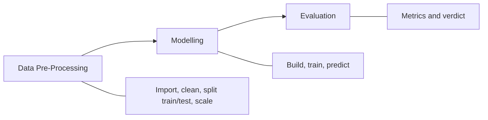
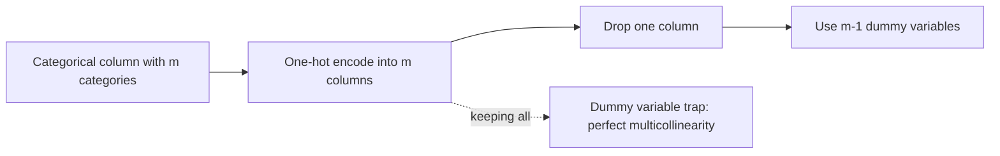
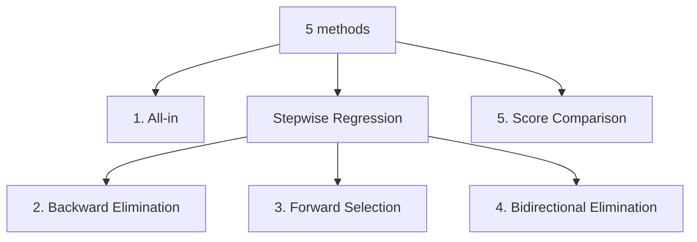
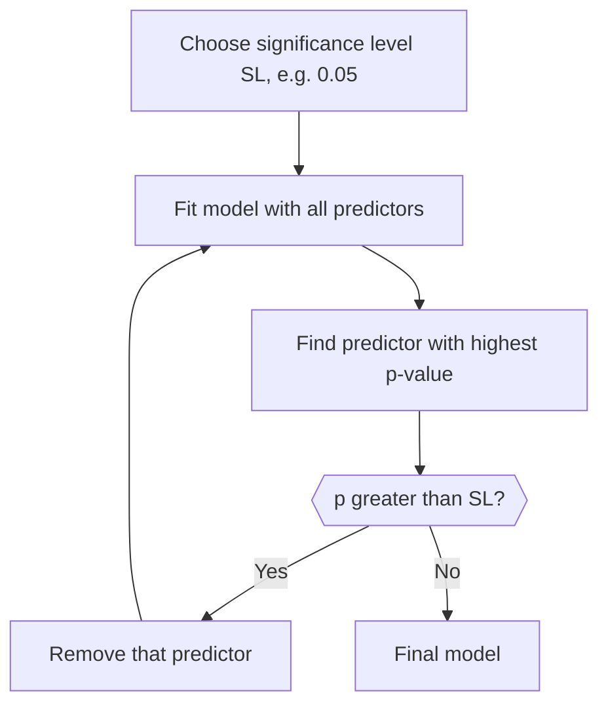
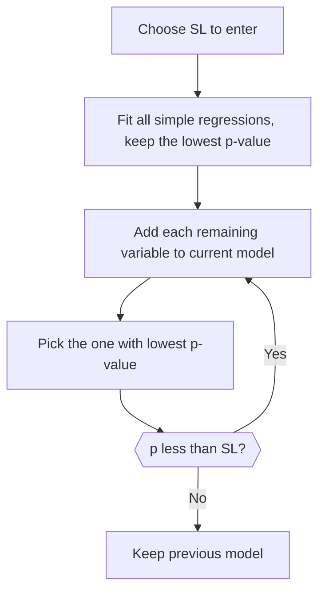
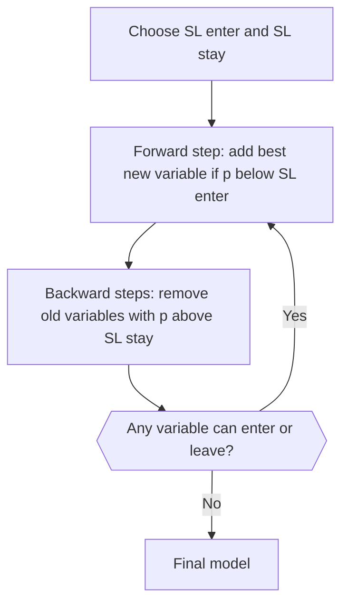

# Regression Fundamentals: Notes with Diagrams

## 1. The Machine Learning Process



## 2. Feature Scaling

```
Normalization:   X' = (X - Xmin) / (Xmax - Xmin)   -> [0, 1]
Standardization: X' = (X - mu) / sigma             -> about [-3, +3]
```

The same data points on three scales. The shape is preserved; only the units change.

## 3. Simple Linear Regression

```
y_hat = b0 + b1 * X1
```

b0 is where the line crosses the y-axis, b1 is the slope, and the residual is the gap between a point and the line.

## 4. R Squared

```
SS_res = SUM (y_i - y_hat_i)^2
SS_tot = SUM (y_i - y_avg)^2
R^2 = 1 - SS_res / SS_tot
```

Left: errors around the fitted line. Right: errors around the plain average. The smaller the left errors are compared with the right, the closer R squared is to 1.

| R squared | Meaning |
| --- | --- |
| 1.0 | Perfect (suspicious) |
| about 0.9 | Very good |
| below 0.7 | Not great |
| below 0.4 | Terrible |
| below 0 | Model makes no sense |

## 5. Adjusted R Squared

```
Adj R^2 = 1 - (1 - R^2) * (n - 1) / (n - k - 1)
k = number of independent variables, n = sample size
```

R squared keeps rising as variables are added, even useless ones. Adjusted R squared drops when added variables do not help.

## 6. Assumptions of Linear Regression

How each assumption looks when it is violated. A healthy dataset shows a clean straight band of points, equal spread, bell-shaped errors, and no pattern in order.

## 7. Dummy Variables

| State | New York | California |
| --- | --- | --- |
| New York | 1 | 0 |
| California | 0 | 1 |
| Florida | 0 | 0 |

```
y = b0 + b1*x1 + b2*x2 + b3*x3 + b4*D1
```



## 8. Building a Model



### Backward elimination



### Forward selection



### Bidirectional elimination



### Score comparison


## 9. Polynomial Regression

```
y = b0 + b1*x + b2*x^2 + ... + bn*x^n
```

Linear in its coefficients (the b terms), but nonlinear in its input variable x. The coefficients can still be found with least squares, while the fitted curve bends.

Too low a degree underfits, a suitable degree captures the trend, and a very high degree chases noise (overfitting).